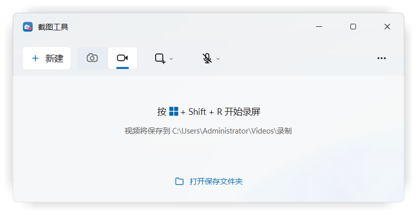
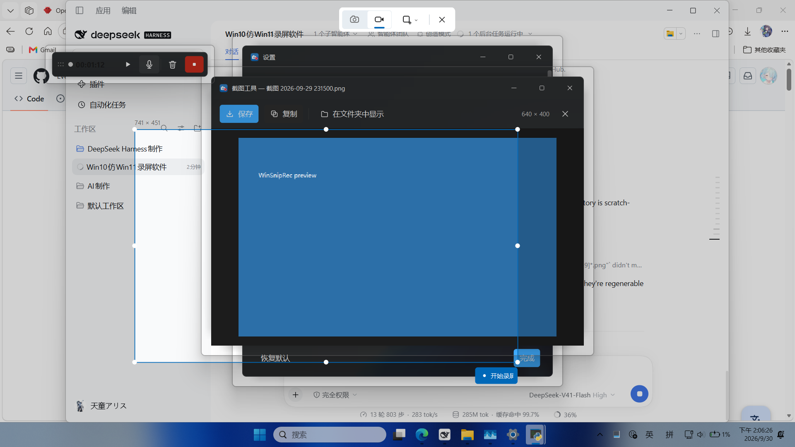
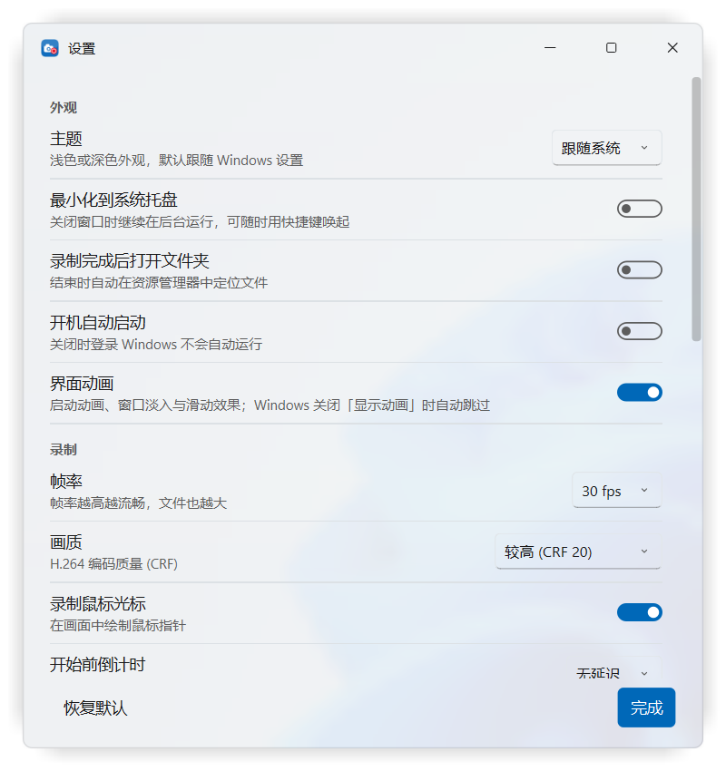
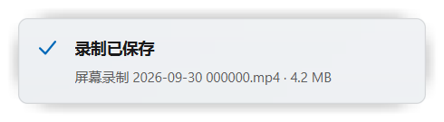
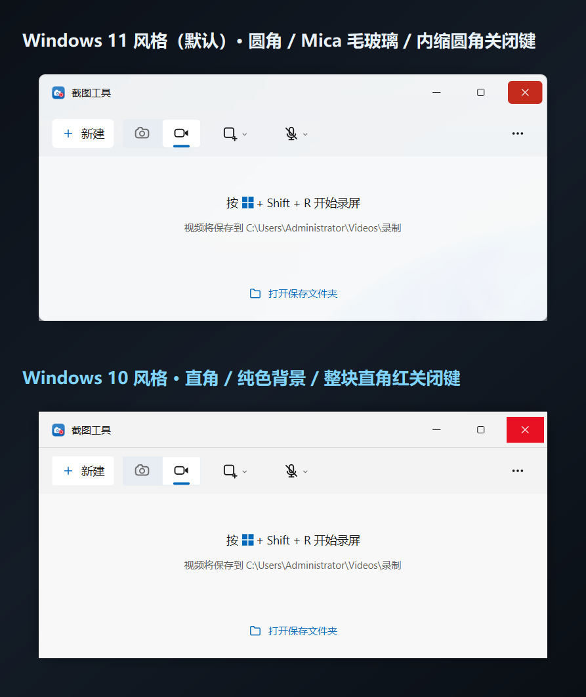

# WinSnipRec — a Windows 11 Snipping Tool experience on Windows 10

> Screen recording and screenshots for **Windows 10**, with the look, icons and
> interaction flow of the **Windows 11 Snipping Tool**.

[中文说明](README.md) · [Changelog](CHANGELOG.md) · [](LICENSE) · [](#requirements)

On Windows 10, `Win+Shift+S` takes a screenshot and `Win+Shift+R` records — but the
recorder Microsoft ships is the old, plain Game Bar. WinSnipRec reproduces the
Windows 11 experience instead: the same Fluent window, the same vector icons and
palette, the same flow — drag a region → record → pause / resume / timer → stop →
get an H.264 MP4.



| | |
|---|---|
|  |  |
|  |  |

## Features

- **Region / window / full-screen recording**, plus screenshots with the same picker
- **Pause & resume** — the final video contains no paused footage
- **Switch microphone mid-recording** without breaking audio/video sync
- **System sound** capture through a loopback device (Stereo Mix / What U Hear)
- **Cursor compositing**, smooth and never dropped
- **Global hotkeys** (`Win+Shift+S` / `Win+Shift+R`) with automatic fallback when
  the real Snipping Tool or another app already owns the combination
- **Start with Windows**, silently into the notification area
- **Light / dark theme** that follows the system, switchable at runtime
- **First-run guide**: a seven-step wizard. The guide window *is* the preview -
  picking a style or theme changes the window you are looking at.
- **Minimize animation**: a snapshot ghost shrinks toward the taskbar while the
  real window minimizes at once, so the layout never reflows mid-flight.
- **Four interface languages**: Simplified Chinese, Traditional Chinese, English
  and Japanese, following the system by default. Folder names, window-title
  matching tables and output file names are deliberately NOT translated.
- **Optional real-time backdrop blur**: Settings -> Appearance -> Backdrop
  (auto / classic / force). Auto *measures pixels* at startup to decide whether
  DWM actually renders a backdrop - both relevant APIs report success on
  machines that draw nothing - and quietly falls back to the wallpaper
  material when it does not.
- **Two interface styles** - Windows 11 (rounded, Mica, Segoe UI Variable) or
  Windows 10 (square corners, **Acrylic** = heavy Gaussian blur + noise grain,
  inset-free square caption hover with the classic `#E81123` close button,
  Segoe UI), or follow the OS. The win10 style also enables **Reveal**, the
  Windows 10 pointer light (low / medium / high, default low, plus a 1px
  hover border on controls). It is drawn on its own overlay layer, so moving the cursor
  repaints only the light's band and never the controls - the settings window
  went from 18 fps to 58 fps. Switching is instant: widgets read the
  radius/material from the theme at paint time, so no window is rebuilt and no
  restart is needed.
- Output: **H.264 MP4** (libx264, adjustable CRF, `+faststart`), 15/24/30/60 fps

## Why it looks like Windows 11 even on Windows 10

[Mica](https://learn.microsoft.com/en-us/windows/apps/design/style/mica) — the
translucent material behind Windows 11 windows — requires Windows 11 build 22000
or newer. Rather than falling back to a flat colour, WinSnipRec **implements the
same principle itself**: it decodes and pre-scales the wallpaper once, caches a
1/16-size base, and crops + upscales it per window. The result on Windows 10 is
what Mica looks like on Windows 11. Every icon is a hand-drawn vector on a 20×20
grid with 1.5 px strokes; the palette is sampled from the real Snipping Tool.

*(This is also why porting the UI to WinUI 3 would be a downgrade here: WinUI 3
on Windows 10 has no Mica and falls back to a solid background.)*

## Requirements

- Windows 10 1809+ or Windows 11, 64-bit
- Python 3.11+ (only for running from source — the released zip is standalone)

## Run from source

```bat
git clone https://github.com/OWNER/REPO.git
cd REPO
python -m venv .venv
.venv\Scripts\pip install -r requirements.txt
.venv\Scripts\python app.py
```

Build a standalone folder (no Python required on the target machine):

```bat
powershell -ExecutionPolicy Bypass -File build_exe.ps1
```

The result lands in `dist\截图工具\` (~200 MB, ffmpeg included). Install it to
`%LOCALAPPDATA%` with shortcuts via `安装到本机.bat`.



## Hotkeys

| Action | Default | Fallback when taken |
|---|---|---|
| Screenshot | `Win+Shift+S` | `Ctrl+Alt+S` |
| Recording | `Win+Shift+R` | `Ctrl+Alt+R` |

Windows 11 users will find the real Snipping Tool already owns `Win+Shift+S/R`,
so WinSnipRec logs the conflict and switches to the fallback automatically.

## Tests

Everything runs offline. 338 assertions across thirteen suites:

```bat
.venv\Scripts\python.exe tests\selftest_core.py        :: 51  recording core
.venv\Scripts\python.exe tests\selftest_animation.py   :: 41  motion & transitions
.venv\Scripts\python.exe tests\selftest_app.py         :: 36  end-to-end UI
.venv\Scripts\python.exe tests\selftest_startup.py     :: 22  run-at-logon
.venv\Scripts\python.exe tests\selftest_overlay.py     :: 21  region picker
.venv\Scripts\python.exe tests\selftest_settings_live.py :: 10 dropdowns on a real desktop
.venv\Scripts\python.exe tests\selftest_duration.py    ::  8  duration regression
.venv\Scripts\python.exe tests\selftest_hotkeys.py     ::  7  global hotkeys
.venv\Scripts\python.exe tests\selftest_mic_switch.py  ::  9  microphone switching
.venv\Scripts\python.exe tests\selftest_style.py      :: 44  styles, Acrylic, Reveal, repaint budget
.venv\Scripts\python.exe tests\selftest_devices.py    :: 15  device scan never blocks the UI
```

`selftest_duration.py` deliberately slows the screen grab down to reproduce the
worst case a virtual machine or remote desktop session would hit, and asserts the
recording still comes out the right length.

## Repository layout

```
app.py                 entry point (logging, single instance, DPI, hotkeys, theme)
winsnip/
  theme.py             Fluent tokens, both interface styles, Mica renderer
  icons.py             every vector icon (20x20 grid, 1.5 px strokes)
  winapi.py            DWM, registry theme, window enumeration, global hotkeys
  startup.py           run-at-logon (HKCU Run key, stale-entry repair)
  anim.py              Fluent motion tokens (durations, curves, window fades)
  core/                screen grab, ffmpeg pipe encoder, audio devices, recorder
  ui/                  main window, overlay, control bar, preview, settings, splash
tests/                 the eight suites above
tools/                 icon / promo art / promo video / benchmark generators
docs/screenshots/      UI reference shots (regenerate: python app.py --selftest-ui)
promo/                 poster art, a 30 s promo video (frame-rendered) and
                       video covers in 16:9 and 4:3
perf/                  measured performance charts
```

## Known issues

- On machines where screen capture is very slow (VMs, remote desktop), the
  encoder may fall behind. The recording is never silently truncated — the app
  tells you and suggests a lower frame rate or a smaller region — but the
  effective frame rate will drop.
- Audio loopback capture needs a device such as "Stereo Mix" to be enabled in
  Windows sound settings; many laptops ship with it disabled.
- The UI is a faithful *reproduction*, not Microsoft code. It is not affiliated
  with or endorsed by Microsoft.

## Contributing

Issues and pull requests are welcome. Before opening a PR please run:

```bat
.venv\Scripts\python.exe -m compileall -q app.py winsnip tests tools
.venv\Scripts\python.exe tests\selftest_core.py
.venv\Scripts\python.exe tests\selftest_duration.py
.venv\Scripts\python.exe tests\selftest_app.py
```

If you change the UI, re-run `python app.py --selftest-ui` and commit the updated
`docs/screenshots/` so reviewers can compare visually.

## License

[MIT](LICENSE) © 2026 WinSnipRec contributors

Dependencies: PySide6 (LGPL), mss, imageio-ffmpeg (bundles FFmpeg — see its
`LICENSE` for LGPL/GPL terms).
