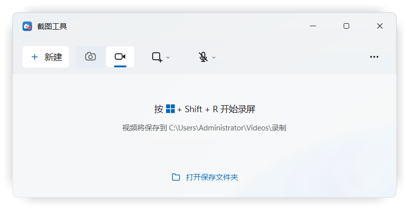
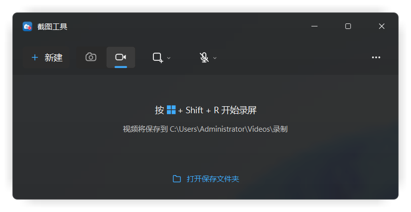
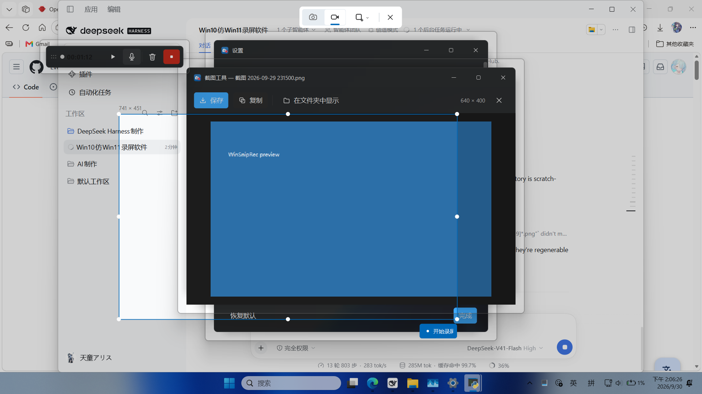
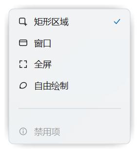
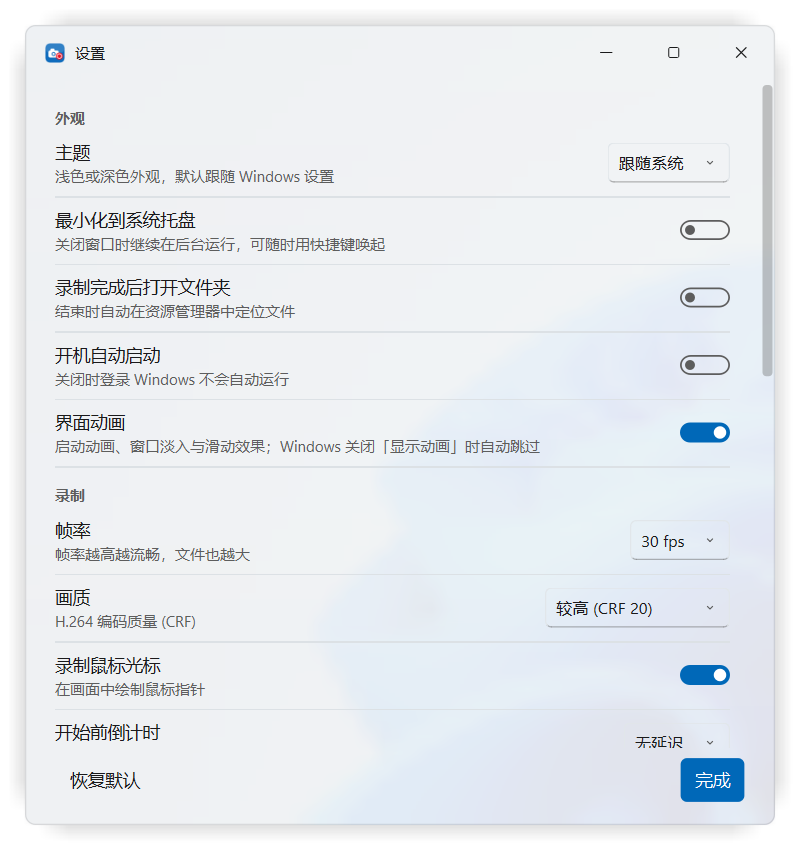
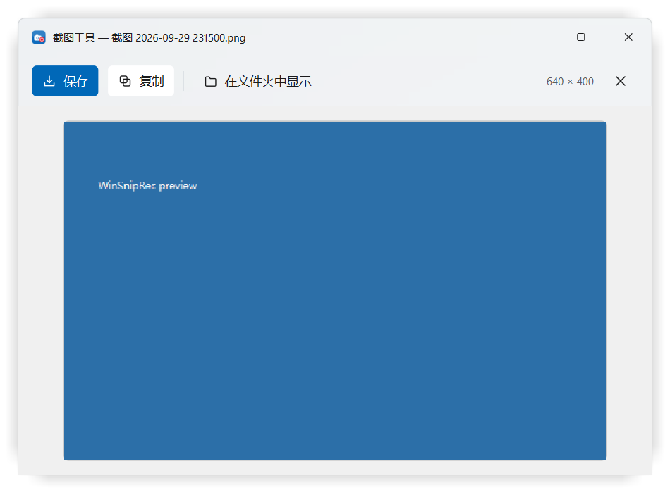
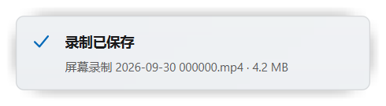
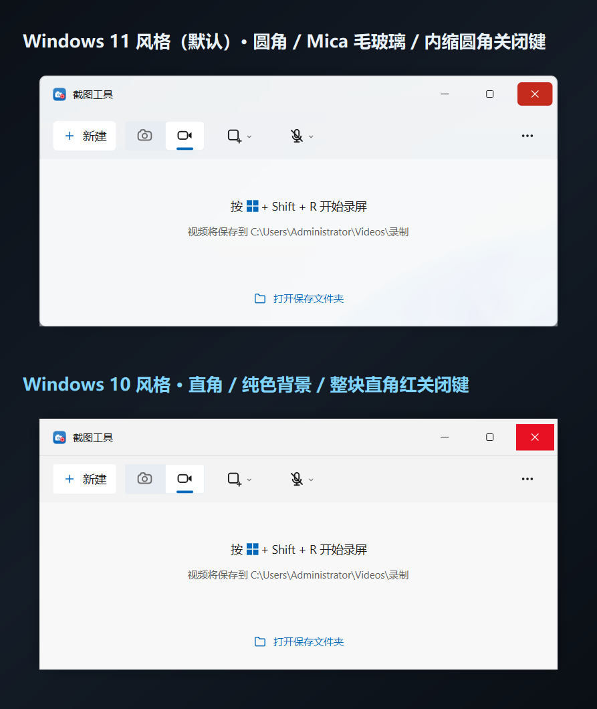

# 截图工具 WinSnipRec

> 在 Windows 10 上复刻 Windows 11「截图工具」的录屏与截图体验。

[English](README.en.md) · [中文](README.md) · [更新日志](CHANGELOG.md)

[](https://github.com/OWNER/REPO/actions/workflows/ci.yml)
[](LICENSE)
[](https://www.python.org/)
[](#)

在 **Windows 10** 上复刻 **Windows 11「截图工具」(Snipping Tool)** 的录屏体验：
同一套 Fluent 界面、同一套图标与配色、同一条操作路径 —— 框选区域 → 开始录制 →
暂停 / 继续 / 计时 → 停止 → 得到 H.264 MP4。

> 界面按 Windows 11 截图工具 11.2602 的实际截图逐像素比对制作：
> Mica 材质、圆角、标题栏按钮、命令栏图标顺序、蓝色选中下划线、正文字号与间距。

---

## 界面预览

全部截图由 `python app.py --selftest-ui` 自动生成（`docs\screenshots\`）。

| 主窗口（浅色） | 主窗口（深色） |
| --- | --- |
|  |  |

| 区域选择浮层（含模式栏 / 手柄 / 尺寸标签 / 确认按钮） | 录制控制条 |
| --- | --- |
|  |  |

| 弹出菜单 | 设置 |
| --- | --- |
|  |  |

| 截图预览窗口 | 通知（Toast） |
| --- | --- |
|  |  |

---

## 1. 功能一览

| 能力 | 说明 |
| --- | --- |
| 录屏区域 | 矩形区域 / 指定窗口 / 整屏（多显示器取当前屏幕）/ 自由绘制（截图模式） |
| 录制控制 | 开始、暂停、继续、停止、放弃（删除临时文件） |
| 计时 | 暂停时计时同步冻结，与 Win11 行为一致 |
| 音频 | 麦克风；系统声音（需要「立体声混音 / What U Hear / VoiceMeeter」等回环设备）；**录制中可随时开/关麦克风**（在分段边界切换，音画同步且总时长不变） |
| 录制光标 | 用 GDI 把鼠标指针合成进画面（可关闭） |
| 输出 | H.264 MP4（libx264，CRF 可调，`+faststart` 便于分享），30/60 fps 可选 |
| 截图 | 区域 / 窗口 / 全屏 / 自由绘制截图，自动复制到剪贴板并保存 PNG，附带预览窗口 |
| 延迟 | 无 / 3 秒 / 5 秒 / 10 秒倒计时 |
| 全局快捷键 | 默认 `Win+Shift+S` 截图、`Win+Shift+R` 录屏；被占用时自动回退并提示 |
| 托盘 | 关闭窗口后驻留通知区域，可继续用快捷键唤起 |
| 开机自启 | 可在设置或 `⋯` 菜单开关；登录 Windows 后**静默进入通知区域**（不弹窗口），快捷键随时可用 |
| 界面语言 | **简体中文 / 繁體中文 / English / 日本語**，默认跟随系统 |
| 主题 | 跟随系统浅色/深色，运行中实时切换 |
| 界面风格 | **Windows 11 / Windows 10 两种风格**，可跟随系统；圆角、材质、标题栏按钮一起变 |
| 启动动画 | 启动画面（图标 + Fluent 进度环）→ 淡入并轻微上滑进入主窗口；可关闭 |
| 界面动画 | Fluent 动效时长与缓动；Windows 关闭「显示动画」时自动跳过 |
| 模式切换动画 | 截图 ⇄ 录屏：底部强调条滑动、选中底色与图标颜色交叉渐变、提示文字淡出上移再淡入 |
| 窗口打开动画 | **所有窗口**统一淡入（普通窗口另加 8~22px 上滑）：主窗口/设置/关于/预览/控制条/倒计时/菜单/通知/区域浮层 |

> **模式切换动了什么**：① 底部蓝色强调条从一档滑到另一档（240ms 减速曲线）；
> ② 选中底色与图标颜色同步交叉渐变（旧变浅、新变深）；
> ③ 中间提示文字先淡出并上移，换文案后从下方淡入（共 300ms）。
> 全部走同一套 `winsnip/anim.py` 时长令牌，并受「界面动画」开关与系统设置约束。

### 首次运行引导

第一次打开会在主窗口之上弹出一个 7 步的引导：欢迎 → 界面风格 → 主题 → 背景材质 →
光效强度 → 界面语言 → 完成。左侧是步骤导航，底部是 跳过 / 第 N / 7 步 / 上一步 / 下一步。

**引导窗口本身就是预览**：它就是一个真的 `FluentWindow`，所以选风格、选主题的那一刻，
用户正在看的这个窗口立刻变成那个样子——没有缩略图要和实际外观同步，也不可能出现
"预览和实际不一致"。光效强度那一步同理：窗口自带跟随鼠标的光，让用户直接把鼠标移上去
划一划就能感受强弱，不需要额外的预览控件。

每一步的选择立刻写入设置。只在首次运行弹出（静默启动 `--tray` 不弹），
随时可以从 **设置 → 重新运行引导** 再来一次。

### 界面语言

设置 → 外观 → **界面语言**，可选 跟随系统 / 简体中文 / 繁體中文 / English / 日本語。

翻译以**简体中文原文为键**（`winsnip/i18n.py`）：漏翻的字符串会退回中文，而不是显示
键名或空白。表格写成 `源文: (繁體, English, 日本語)` 三列，缺哪一列一眼可见；没有
引入 Qt 的 `.ts`/`.qm` 工具链，所以不需要额外的构建步骤，打包也不受影响。

切换语言会**立即作用于整个应用**：任何窗口只要实现 `retranslate()`，
`retranslate_windows()` 就会在切换时重译它——主窗口标题、按钮、截图/录屏分段控件、
托盘菜单、标题栏按钮提示都在内。菜单、通知与对话框是按需构建的，本来就会用新语言。

字体随语言切换：日文用 **Yu Gothic UI**（假名在只列中文字体时会掉字形），
繁中用 **Microsoft JhengHei UI**。

**有几类字符串是故意不翻译的**，翻译会出问题：

| 不翻译 | 原因 |
|---|---|
| `Videos\录制`、`Pictures\屏幕截图` | 是**文件夹名**，翻译会改变用户的保存位置 |
| `winapi.py` 的窗口标题忽略表 | 用于**匹配**窗口，不是显示 |
| `__init__.py` 的应用名 | 也用于识别自己的窗口 |
| 输出文件名 `截图 xxx.png` | 保持跨语言稳定，脚本与自测依赖它 |

`tests/selftest_i18n.py` 会遍历 AST 检查**所有用户可见的中文字符串都经过 `_t()`**，
以后新加的标签不可能悄悄漏翻；同时也断言默认保存路径没被翻译。

### 两种界面风格

设置里的「界面风格」可以选 **跟随系统 / Windows 11 / Windows 10**，默认 Windows 11：

| | Windows 11（默认） | Windows 10 |
|---|---|---|
| 窗口圆角 | 8px 圆角 | **直角** |
| 材质 | **Mica**：轻模糊壁纸 + 主题着色 | **Acrylic 亚克力**：重高斯模糊 + 噪点颗粒 + 更实的着色 |
| 鼠标光效 | 无 | **Reveal**：柔光跟随鼠标（强度 低/中/高，默认低），按钮另有悬停描边 |
| 标题栏按钮 | 悬停内缩圆角、关闭键 `#C42B1C` | 悬停**铺满整格直角**、关闭键经典红 `#E81123` |
| 标题栏分隔线 | 无（与内容融为一体） | **有**一条分隔线 |
| 控件圆角 / 字体 | 5px / Segoe UI Variable | 2px / Segoe UI |
| 阴影 | 柔和、扩散大 | 更紧更深 |



切换是**即时生效**的：所有窗口都改成在绘制时读主题（`theme.radius_window` 等），
不需要重建窗口，也不需要重启。

### 背景材质：实时模糊还是壁纸模糊

设置里的「背景材质」有三档：

| 档位 | 行为 |
|---|---|
| **自动**（默认） | 启动时探测本机能否真正渲染系统背景模糊，能就用真的，不能就回退 |
| 经典（壁纸） | 始终用下面这套壁纸材质的实现 |
| 强制实时 | 跳过探测，直接要求系统实时模糊 |

**两种做法的区别**：经典的实现是"读壁纸文件 → 缩小 → 放大 → 染色"，只对壁纸有效，
窗口后面的其他窗口不会出现在模糊里；系统实时模糊则由 **DWM 合成**，真·实时、CPU
零开销（Win11 22H2+ 用 `DWMWA_SYSTEMBACKDROP_TYPE`，Win10 1803+ 用
`SetWindowCompositionAttribute` 的 `ACCENT_ENABLE_ACRYLICBLURBEHIND`）。

**为什么默认是"自动"而不是直接用系统接口**：这两个 API 在不少环境里会**返回成功
却什么都不画**。所以可用性是**用像素判定**的（`winsnip/backdrop.py`）：建一个临时的
非分层窗口，先截屏、应用材质、再截屏、比像素；没变化就判定不支持。作者这台机器就是
这种情况 —— API 返回 `hr=0`，像素零变化，系统自带的开始菜单在这里也是不透明的。
任何异常都会被当作"用经典材质"，失败不会冒泡。

> 原生路径有个前置条件：窗口不能是**分层窗口**，而 `WA_TranslucentBackground` 正是
> 分层窗口的来源。所以原生路径会把阴影留白归零，另用 `SetWindowRgn` 把窗口裁成圆角，
> 客户区只画一条 1px 描边（多画一点就会盖住背景）。菜单、通知这类小浮层仍然走经典路径。

**Acrylic 与 Mica 的区别不是"有没有模糊"，而是模糊的程度和配方**：Mica 用 1/16
缩放的壁纸做一次平滑放大，保留壁纸的构图；Acrylic 额外走三级平滑下采样/上采样
近似高斯模糊，把构图彻底糊掉，再叠一层噪点（否则大面积极渐变会出现色带），最后
用更实的窗口色压上去。所以 Win10 风格下"感觉得到桌面在背后，但看不出来是什么"。

**Reveal** 是 Windows 10 首创的高光跟随效果，设置里可选强度（**低 / 中 / 高，默认低**）。

窗口每 33ms 读一次光标位置（子控件会吃掉 mouseMove，所以不能只靠事件），在指针处
画一圈柔光。浅色主题下用强调色做光（白光在近白背景上只有 4% 对比，等于看不见），
深色主题用白光。按钮悬停时另有一条 1px 描边，这是 Reveal 的另一半。

**流畅度**：光画在**独立浮层**上，而不是窗口自己或各控件里。设置窗口有几十个控件，
整窗重绘要 45 ms；让每个控件各自补一份光更慢。改成浮层之后，移动鼠标只会重绘浮层
上光斑所在的一小块（约 34% 窗口面积），控件一次都不重绘——设置窗口从
**18 fps 提到 58 fps**。另外卡片本身（阴影 + 材质 + 边框）会缓存成一张位图，
每帧只需贴一次图，不用重新合成阴影和亚克力背景。

### 关于 WinUI 3

经常有人问「能不能直接用 WinUI 3」——结论是**技术上可以，但这个项目上不划算**：

| | |
| --- | --- |
| 系统支持 | Windows App SDK 支持 Win10 1809+，Win10 上确实能跑 |
| 语言绑定 | WinUI 3 **没有 Python 绑定**，要用 C#/C++ 重写整个界面（约 5000 行），录制内核也得重写或拆成伴随进程 |
| 运行库 | 需要额外安装 Windows App Runtime；自带则包体积 +40~90MB |
| **关键点** | **Mica 毛玻璃要求 Win11 22000+**。Win10 上 WinUI 3 会退化成纯色背景 —— 也就是说，Win10 上换成 WinUI 3，界面**反而比现在更不像** Win11 截图工具。本项目的做法是直接按 Mica 的原理（模糊桌面壁纸 + 主题着色）自己合成，所以在 Win10 上得到的是 Win11 的观感 |
| 圆角/贴靠布局 | 部分属于 Win11 外壳特性，Win10 上同样拿不到 |

所以这里的选择是：**保留现有架构（外形已经与 Win11 截图工具逐像素对齐），把 WinUI 3 真正能被感知到的部分——Fluent 动效——补上**。
如果你确实需要 WinUI 3 原生实现，那是另一个工程（C# 重写），可以单独开工。

---

## 2. 与 Windows 11 截图工具的界面对照

| 界面元素 | Windows 11 截图工具 | 本程序 |
| --- | --- | --- |
| 窗口背景 | Mica（模糊桌面壁纸 + 主题着色） | ✅ 读取注册表壁纸并按 Windows 的填充方式（填充/适应/拉伸/平铺/跨屏）重建，经 32 倍降采样高斯模糊 + 主题着色 |
| 窗口圆角 / 阴影 | 8px 圆角 + 系统投影 | ✅ 自绘 8px 圆角 + 缓存模糊投影；Win11 上同时调用 DWM 圆角属性 |
| 标题栏 | 应用图标 + 标题 + 最小化/最大化/关闭 | ✅ 同款按钮尺寸（46×32）、关闭按钮悬停变红 `#C42B1C` |
| 命令栏 | `＋ 新建`、相机/摄像机分段开关、区域▾、声音▾、`⋯` | ✅ 同序；分段开关选中项为白色卡片 + 蓝色下划线 |
| 图标 | Segoe Fluent Icons | ✅ 全部按 Fluent System Icons 的 20×20 / 1.5 描边规范用 QPainter 矢量重绘，Win10 与 Win11 显示完全一致 |
| 提示文字 | 「按 ⊞ + Shift + S 开始截图」 | ✅ 同款内联 Windows 徽标 + 快捷键文本 |
| 区域选择浮层 | 屏幕压暗 + 冻屏 + 十字光标 + 放大镜 + 尺寸标签 | ✅ 全部实现，顶部浮动模式栏可切换截图/录屏与区域类型 |
| 录制控制条 | 计时 + 暂停 + 停止 + 麦克风 | ✅ 红色停止键、暂停/继续、`00:00:00` 计时、麦克风开关、放弃与拖动手柄 |
| 强调色 | 系统强调色（默认 `#0067C0`） | ✅ 读取 `HKCU\...\DWM\AccentColor`，深色主题用 `#60CDFF` |

**有意的差异**（更贴合本程序的功能语义，已在代码中注明）：
命令栏第 4 组图标使用**麦克风**（而非截图工具里的「摄像机 + 斜杠」），因为它控制的是声音录制；
录制控制条按 Win11 录屏条的构成实现（停止 / 暂停 / 计时 / 麦克风 / 放弃），未包含截图工具的
标注编辑器（画笔、荧光笔、裁剪、OCR）。

---

## 3. 运行

### 方式 A：一键安装（推荐）

1. 先打包（只需一次）：

   ```powershell
   powershell -ExecutionPolicy Bypass -File build_exe.ps1
   ```

2. 双击 **`安装到本机.bat`** —— 会把程序复制到
   `%LOCALAPPDATA%\Programs\WinSnipRec`，并在**桌面**和**开始菜单**创建「截图工具 WinSnipRec」快捷方式，
   然后自动启动一次做冒烟测试。无需管理员权限。

   卸载：`安装到本机.bat uninstall`

### 方式 B：直接运行打包好的程序

```
dist\截图工具\截图工具.exe
```

双击即可，无需安装 Python。首次运行会在 `%APPDATA%\WinSnipRec\settings.json` 写入配置。

### 方式 C：从源码运行

```bat
:: 1. 建虚拟环境（需要 Python 3.10 - 3.13）
py -3 -m venv .venv
.venv\Scripts\python.exe -m pip install -r requirements.txt

:: 2. 启动
.venv\Scripts\pythonw.exe app.py
```

或直接双击 **`启动截图工具.bat`**（会自动寻找 `.venv` 或上一级目录的 `.venv`）。

命令行参数：

| 参数 | 作用 |
| --- | --- |
| `--tray` | 启动后直接最小化到通知区域 |
| `--open-settings` | 启动时直接打开「设置」窗口 |
| `--selftest-ui` | 渲染所有窗口并截图到 `docs\screenshots\`，用于界面回归 |
| `--selftest-record` | 录制 1.6 秒并把结果写入 `selftest_record.txt`，用于验证**打包后**的程序 |
| `--selftest-quit` | 验证「最小化到托盘」下仍能正常退出（回归防护） |

> 启动速度：在带真实显卡的 Windows 10 上通常 1–2 秒即可出界面；
> 在虚拟机 / 远程桌面的纯软件渲染环境下，首次显示半透明窗口与 Mica 背景会明显偏慢（本机实测约 5–7 秒），
> 这是显示驱动的合成开销，程序本身已把背景生成从每次约 1 秒优化到约 20 毫秒。

---

## 4. 快捷键

| 快捷键 | 作用 | 备注 |
| --- | --- | --- |
| `Win+Shift+S` | 截图 | Windows 11 上被系统截图工具占用，会自动回退到 `Ctrl+Alt+S` 并弹出提示 |
| `Win+Shift+R` | 录屏 | 同上，回退到 `Ctrl+Alt+R` 或 `Ctrl+Shift+R` |
| `Ctrl+Alt+P` | 录制中暂停 / 继续 | 录制期间临时注册 |
| `Ctrl+Alt+Q` | 录制中停止 | 录制期间临时注册（**不用 `Ctrl+Alt+S`**，避免与截图快捷键抢注册） |
| `Esc` | 取消区域选择 | 浮层会主动抢占前台，确保 Esc 一定生效 |
| `Enter` | 确认区域选择 | 仅在开启「框选后需要确认」时用到 |
| `Ctrl+A` | 在区域选择中改为整屏 | |

> **框选后是否立即开始**：默认与 Windows 11 一致 —— 松开鼠标立刻开始录制/截图。
> 若想先微调区域，可在「设置 → 框选后需要确认」中打开，此时拖拽完成后可拖动手柄调整，
> 再按回车或点击浮层上的确认按钮开始。

---

## 5. 关于「系统声音」

Windows 10 没有给桌面程序开放系统声音回环接口，ffmpeg 的 `dshow` 也只能看到
真实存在的录音设备。因此本程序的做法是：

1. 在「设置 → 音频 → 系统声音设备」中列出所有**回环类**设备
   （名称含 `立体声混音`/`Stereo Mix`/`What U Hear`/`VoiceMeeter`/`CABLE Output` 等）；
2. 选择其中任意一个即可录制系统声音。

若列表为空，请在 **声音设置 → 录制** 中右键显示已禁用的设备并启用「立体声混音 (Stereo Mix)」。

---

## 6. 开机自动启动

在**设置 → 外观 → 开机自动启动**，或工具栏 `⋯` 菜单里直接勾选。

* 注册位置是**当前用户的** `HKCU\Software\Microsoft\Windows\CurrentVersion\Run` 下的
  `WinSnipRec` 值 —— 不需要管理员权限，卸载时一并清理。
* 注册的命令行带 `--tray`：登录后**只在通知区域静默运行，不会弹出窗口**，
  主窗口按需从托盘打开，快捷键（`Win+Shift+S` / `Win+Shift+R`）立刻可用。
* 程序被移动位置后会自检：若启动项指向的文件已不存在，会自动改指当前这一份并提示。
* 用 `安装到本机.bat` 安装时，卸载（`安装到本机.bat uninstall`）会同时删掉这个启动项。

命令行方式：

```powershell
powershell -ExecutionPolicy Bypass -File tools\install.ps1 -Autostart   # 安装时顺带开启
```

---

## 7. 打包

```powershell
powershell -ExecutionPolicy Bypass -File build_exe.ps1
```

脚本会：生成图标 → 用 PyInstaller 打成**单文件、无控制台**的 `dist\截图工具.exe`
→ 附带 `ffmpeg.exe`（取自 `imageio-ffmpeg`）→ 运行一次冒烟测试。

在 Windows 10 与 Windows 11 上均可直接分发；程序只在 Win10 1809 及以上版本使用 API。

### 安装包（Inno Setup）

```powershell
powershell -ExecutionPolicy Bypass -File build_installer.ps1
```

默认会先跑一遍 `build_exe.ps1`，再编译安装包；已经打包过主程序就加 `-SkipAppBuild`，
大概 4~5 分钟（LZMA2 压缩 200 MB 整包比较慢）。

产物：`dist\installer\WinSnipRec-Setup-<版本>.exe`，**55.5 MB**。

| 行为 | 说明 |
| --- | --- |
| 安装位置 | `%LOCALAPPDATA%\Programs\WinSnipRec`，**全程不需要管理员权限** |
| 可选项 | 桌面快捷方式（默认勾）、开机自动启动（默认不勾） |
| 开始菜单 | 「截图工具」程序组，含主程序和卸载入口 |
| 升级 | 按 `AppId` 识别旧版本，直接覆盖安装 |
| 卸载 | 删除程序、快捷方式与开机自启项；**保留** `%APPDATA%\WinSnipRec` 里的个人设置 |
| 界面语言 | 简体中文（社区翻译），缺失时自动回退英文 |

依赖只有一个 Inno Setup 6：

```bat
winget install --id JRSoftware.InnoSetup -e
```

中文语言文件按需自动下载（不随仓库分发）；要装到 `Program Files` 就把
`tools\installer.iss` 里的 `PrivilegesRequired` 改成 `admin`、
`DefaultDirName` 换成 `{autopf}`。

### 发布新版本

安装包约 **50 MB**，**不要提交进仓库**（GitHub 单文件硬上限 100 MB、
网页上传上限 25 MB）。走 Release：

```bat
git tag v1.1.0
git push origin v1.1.0
```

版本号只有一个来源：`winsnip/__init__.py` 里的 `__version__`。安装包文件名、
程序「关于」窗口、启动画面都读它；Release 工作流则从 tag 推导（`v1.1.0` → `1.1.0`）。

推 tag 后 GitHub Actions 自动完成：跑自测 → 打包主程序 → 压缩免安装版 →
编译安装包 → 生成 `SHA256SUMS.txt` → 创建 Release 并附上两个产物。

也可以手动触发：Actions → Release → Run workflow，填入版本号即可。

> 首次运行约 10~15 分钟（要装 Inno Setup 和依赖）。抓屏相关的自测在 runner 上
> 是无桌面环境，可能不稳定，所以设为不阻塞发布；代码质量由 CI 在 push 时把关。

---

## 8. 目录结构

```
WinSnipRec/
├── app.py                     程序入口（日志、单实例、DPI、快捷键、主题跟随）
├── requirements.txt
├── 启动截图工具.bat            源码方式启动
├── 安装到本机.bat              安装到 %LOCALAPPDATA% + 创建快捷方式
├── build_exe.ps1              PyInstaller 打包
├── build_installer.ps1        生成 Inno Setup 安装包
├── assets/                    app.ico 及多尺寸 PNG
├── tools/
│   ├── make_icon.py           由矢量图标生成 .ico
│   ├── make_promo.py          生成宣传图（promo\）
│   ├── make_perf_charts.py    生成性能图表（perf\）
│   ├── make_promo_video.py    逐帧渲染宣传视频（promo\video\）
│   ├── make_update_video.py   渲染 1.1.0 更新宣传片（30s，可配乐）
│   ├── make_video_cover.py    生成视频封面（16:9 / 4:3）
│   ├── bench_encode.py        编码 CPU 基准
│   ├── bench_runtime.py       内存 / 抓屏 / 启停基准
│   ├── installer.iss          Inno Setup 安装包脚本
│   └── install.ps1            免安装版的安装 / 卸载逻辑
├── promo/                     宣传图（横版 / 竖版 / 方形）
├── promo/video/               宣传视频（30s MP4 + 字幕 + 分镜表）
├── perf/                      性能图表
├── winsnip/
│   ├── theme.py               Fluent 设计令牌 + 双风格（Win11/Win10）+ Mica 渲染
│   ├── icons.py               全部矢量图标（20×20 网格 / 1.5 描边）
│   ├── winapi.py              DWM、注册表主题、窗口枚举、全局热键、DPI
│   ├── startup.py             开机自启（HKCU Run 项读写与失效修复）
│   ├── anim.py                Fluent 动效（时长/缓动/窗口淡入滑动）
│   ├── settings.py            设置持久化
│   ├── core/
│   │   ├── screen.py          显示器信息与像素抓取（mss）
│   │   ├── encoder.py         ffmpeg 定位与 rawvideo→H.264 管道编码
│   │   ├── audio.py           dshow 音频设备枚举
│   │   └── recorder.py        分段录制（暂停/继续/换麦克风）+ 无损拼接与混流
│   └── ui/
│       ├── widgets.py         无边框 Mica 窗口、Fluent 按钮/开关/菜单/通知
│       ├── main_window.py     主窗口（截图工具同款）
│       ├── splash.py          启动画面 + Fluent 进度环
│       ├── overlay.py         全屏区域选择浮层
│       ├── control_bar.py     录制控制条 + 倒计时
│       ├── preview.py         截图预览窗口
│       ├── settings_dialog.py 设置与关于
│       ├── hotkeys.py         全局快捷键管理
│       ├── selftest_ui.py     界面回归截图
│       └── selftest_frozen.py 打包产物自检（--selftest-record）
└── tests/
    ├── selftest_core.py         录制内核自测（51 项：编码、暂停、音频、时长、光标）
    ├── selftest_app.py          端到端自测（36 项：完整 UI 流程 + 菜单 + 下拉框 + 图标配色 + 产物校验）
    ├── selftest_overlay.py      区域选择交互自测（21 项：拖拽、调整、窗口拾取、取消）
    ├── selftest_settings_live.py 真实桌面下拉框自测（10 项：深浅主题下的实际像素）
    ├── selftest_hotkeys.py      全局快捷键自测（7 项：注册 + 真实按键注入）
    ├── selftest_startup.py      开机自启自测（22 项：注册表读写 + 失效修复 + 模拟登录）
    ├── selftest_animation.py    动效自测（41 项：启动动画、全窗口淡入、模式切换、进度环、居中）
    ├── selftest_duration.py     时长回归（8 项：人为拖慢抓屏，验证分段不被静默丢弃）
    ├── selftest_style.py        风格自测（61 项：圆角、Acrylic、Reveal 光效/光色/菜单配色）
    ├── selftest_devices.py      设备枚举自测（15 项：绝不阻塞 GUI 线程）
    ├── selftest_backdrop.py     背景材质自测（13 项：像素探测、回退、设置项）
    ├── selftest_i18n.py         多语言自测（21 项：覆盖检查、整应用重译、路径不改写）
    ├── selftest_onboarding.py   引导自测（17 项：步骤顺序、写入设置、只弹一次）
    └── selftest_mic_switch.py   录制中切换麦克风自测（9 项：时长不变、音画同步）
```

---

## 9. 验证

全部自测均可离线运行，共 **335 项断言**，当前全部通过：

```bat
.venv\Scripts\python.exe tests\selftest_core.py            :: 51/51  内核
.venv\Scripts\python.exe tests\selftest_app.py             :: 36/36  端到端 UI 流程 + 弹出菜单 + 下拉框 + 图标配色
.venv\Scripts\python.exe tests\selftest_overlay.py         :: 21/21  区域选择交互
.venv\Scripts\python.exe tests\selftest_hotkeys.py         ::  7/7   全局快捷键（注入真实按键）
.venv\Scripts\python.exe tests\selftest_mic_switch.py      ::  9/9   录制中切换麦克风
.venv\Scripts\python.exe tests\selftest_startup.py         :: 22/22  开机自启（含模拟登录）
.venv\Scripts\python.exe tests\selftest_animation.py       :: 41/41  启动动画、模式切换、全窗口打开动画
.venv\Scripts\python.exe tests\selftest_duration.py        ::  8/8   时长回归（拖慢抓屏的最坏情况）
.venv\Scripts\python.exe tests\selftest_style.py           :: 61/61  两种风格 + 光效 + 菜单配色 + 重绘预算
.venv\Scripts\python.exe tests\selftest_devices.py         :: 15/15  音频设备枚举不阻塞界面
.venv\Scripts\python.exe tests\selftest_backdrop.py        :: 13/13  实时背景材质的探测与回退
.venv\Scripts\python.exe tests\selftest_i18n.py            :: 21/21  四种语言、整应用重译与覆盖检查
.venv\Scripts\python.exe tests\selftest_onboarding.py      :: 17/17  首次运行引导
.venv\Scripts\python.exe tests\selftest_settings_live.py   :: 10/10  真实桌面上的设置下拉框
.venv\Scripts\python.exe app.py --selftest-ui              :: 生成 16 张界面截图
```

`selftest_startup.py` 会真的写注册表、真的把程序按登录命令拉起来验证「静默进托盘」，
最后**恢复测试前的原值**，不会改动你的自启设置。

另外还有一条真实桌面链路测试（会真的按键、真的拖拽、真的产出 MP4）：

```powershell
powershell -ExecutionPolicy Bypass -File tools\live_hotkey_test.ps1
```

它会依次验证：按下截图快捷键 → 浮层出现 → Esc 取消 → 按下录屏快捷键 → 拖拽区域 →
**松开即开始录制** → 录制中再按录屏键被忽略 → 按 `Ctrl+Alt+Q` 停止并生成 MP4。

测试使用 `%WINSNIPREC_HOME%` 指向独立目录，**不会污染**真实安装的配置。

打包完成后还可以验证**成品 EXE 本身**能录屏（确认 ffmpeg 已随包分发、抓屏与编码可用）：

```bat
dist\截图工具\截图工具.exe --selftest-record
type dist\截图工具\selftest_record.txt      :: 末尾应为 FROZEN SELFTEST: PASS

dist\截图工具\截图工具.exe --selftest-quit   :: 应在数秒内自行退出
```

`selftest_app.py` 会真实录制 640×400 区域约 5 秒（中间暂停 1.2 秒），再用 ffmpeg 校验：
容器时长与「有效录制时间」一致（暂停不进入成片）、`h264 yuv420p 640x400 30 fps`、
关声时无音轨、抽帧后不是黑屏。

`selftest_overlay.py` 用 `QTest` 真实模拟鼠标：拖拽选区、八向手柄缩放、
方向键微调、双击确认、Esc 取消、整屏预选、窗口拾取（含跳过 IME 等不可见辅助窗口）。

`selftest_core.py` 还会验证暂停不进入成片、`stop()` 不卡死（1.2–4.3 秒）、
`elapsed_changed` 约 10 Hz、鼠标指针已合成进画面、奇数尺寸自动收敛为偶数。

---

## 10. 已知限制

* **系统声音**依赖回环设备，Windows 10 默认不启用「立体声混音」；程序会在开关时提示。
* **麦克风开启后** dshow 有约 1 秒预热，该段以静音补齐，因此每段开头可能有极短的静音；
  暂停/切换麦克风都会产生分段，分段之间是无损拼接（不重编码），音画不会漂移。
* **录制控制条**默认自动摆放到录制区域之外；如果录制整屏，控制条会出现在画面内
  （同时程序会尝试 `SetWindowDisplayAffinity(WDA_EXCLUDEFROMCAPTURE)`，
  该能力需要 Windows 10 2004+，且仅对部分捕获方式生效）。
* 纯软件桌面（虚拟机/远程桌面）上 BitBlt 抓屏约 33 ms/帧，30 fps 依赖时间轴补帧；
  编码器持续跟不上时会自动降低有效帧率而不是无限制堆积。
* 超过 4K 的超宽区域在高帧率下受限于软件编码性能。
* 自由绘制区域仅用于截图（与 Windows 11 录屏一致，录屏只支持矩形/窗口/全屏）。
* 全局快捷键若被系统「截图工具」占用（Windows 11 上 `Win+Shift+S/R` 默认被占用），
  程序会自动回退到 `Ctrl+Alt+S` / `Ctrl+Alt+R` 等备用组合并弹出提示。

---

## 11. 宣传图

宣传图由程序生成（复用应用自己的配色、图标、字体与**真实界面截图**，所以和软件本体完全一致）：

```bat
.venv\Scripts\python.exe tools\make_promo.py     :: 输出到 promo\
```

| 文件 | 尺寸 | 建议用途 |
| --- | --- | --- |
| `promo\promo_1920x1080.png` | 横版 16:9 | 论坛帖、群公告、电脑屏幕 |
| `promo\promo_1080x1920.png` | 竖版 9:16 | 手机分享、朋友圈 |
| `promo\promo_1080x1080.png` | 方形 1:1 | 群头像、小红书 |

图中的「区域选择」演示是**合成**的：脚本会临时构造一个虚拟桌面（而不是截取你的真实屏幕），
再用应用自己的浮层渲染冻结画面、压暗、选区边框、尺寸标签与确认按钮，因此不会泄露桌面内容。

---

## 12. 宣传视频

`promo\video\` 下有两支 **30 秒 / 16:9 / 1920×1080 / 30fps** 的宣传片，画面全部由程序逐帧合成：

| 文件 | 内容 |
|---|---|
| `promo_1920x1080_30s.mp4` | 首版功能总览 |
| `update_1920x1080_30s.mp4` | **1.1.0 更新片**：Win10 风格切换 / Acrylic 对比 / Reveal 光效 |

更新片的画面全部来自程序自身：两种风格的窗口是 `MainWindow` 的离屏实拍，
Reveal 光晕直接调用 `RevealOverlay.glow_pixmap()`（用程序真正的渐变，
不是在视频里重画近似），所以片子不会和软件走样。

```bat
.venv\Scripts\python.exe tools\make_update_video.py            :: 渲染更新片
.venv\Scripts\python.exe tools\make_update_video.py --preview   :: 只出每秒一帧的预览网格
```

### 配乐

仓库不附带任何商业音乐。拿到你自己的音乐文件后用这个脚本混入
（音乐自动循环铺满、响度归一到 -18 LUFS、结尾淡出，视频流直接复制不重新编码）：

```bat
powershell -ExecutionPolicy Bypass -File promo\video\混入音乐.ps1 ^
    -Music "D:\music\Watch Me Work.mp3" -Offset 32 -Volume 0.35
```

`-Offset` 用来跳过前奏直接进主歌/副歌。

**切点对齐**：所有切点量化到 **300 ms 的脉冲**（`tools\make_update_video.py --quantum 0.3`）。
这样做的原因是实测数据：对配乐做自相关，900 ms（66.7 BPM）与 600 ms（100 BPM）
两个周期都很强，重拍间隔集中在 305 ms —— 三者都是 300 ms 的整数倍，所以量化到
300 ms 后，无论真实速度取哪一个，剪辑都踩在拍上，不用赌一个 BPM。

> 配好的成品（`*_配乐.mp4`）已在 `.gitignore` 里：仓库不附带、也不提交任何
> 商业音乐的混音产物，请自行保留。

```bat
.venv\Scripts\python.exe tools\make_promo_video.py            :: 渲染成片（约 76 秒）
.venv\Scripts\python.exe tools\make_promo_video.py --preview  :: 只出 30 帧审阅网格
.venv\Scripts\python.exe tools\make_video_cover.py            :: 生成 16:9 与 4:3 封面
.venv\Scripts\python.exe tools\make_video_cover.py --play     :: 需要时在中间叠加播放按钮
```

封面默认**不加**播放按钮（平台通常自己会画一个）。标题占满上半幅是为了缩略图尺寸下
仍然读得清；右下压着录制控制条，一眼能看出是录屏工具而不是截图工具。

**为什么不录屏**：本机 1080p 抓屏一帧要 112ms（上限 9fps），半透明窗口合成要数秒，
真录出来会又卡又抖 —— 反而比软件实际表现差。逐帧合成可以做到精确 30fps、
帧级卡点，而且用的还是应用**真实的控件**（离屏 `grab()`），不是画的假界面。

| 交付物 | 说明 |
| --- | --- |
| `promo_1920x1080_30s.mp4` | 成片（H.264 + AAC + faststart，2.8 MB） |
| `promo_1920x1080_30s.srt` | 字幕，时间轴与画面严格对齐 |
| `storyboard.md` | 分镜表 + 音效节拍表 |
| `contact_sheet.png` | 30 帧审阅网格（每秒 1 帧） |
| `cover_16x9_1920x1080.png` | **视频封面 16:9**（1920×1080） |
| `cover_4x3_1440x1080.png` | **视频封面 4:3**（1440×1080，单独排版，不是裁切） |
| `sfx_track.wav` | 合成出来的 UI 音效轨（点击/滑动/提示/快门） |
| `混入BGM.ps1` | 把你自己的 BGM 混进来（视频流不重编码） |

音效由 numpy 现场合成（无需任何外部素材、无版权问题），并留出 BGM 位：

```powershell
powershell -ExecutionPolicy Bypass -File promo\video\混入BGM.ps1 -Music "D:\music\bgm.mp3" -Volume 0.22
```

---

## 13. 性能实测

图表在 `perf\`，数据全部来自本机实测（i7-6700HQ 4 核 8 线程 / 2.6GHz · 16GB，
就是程序自己的编码参数），可用以下脚本复现：

```bat
.venv\Scripts\python.exe tools\bench_encode.py     :: 纯编码 CPU（已扣除素材生成开销）
.venv\Scripts\python.exe tools\bench_runtime.py    :: 内存 / 抓屏 / 启停
.venv\Scripts\python.exe tools\make_perf_charts.py :: 生成 perf\ 下的图表
```

| 图表 | 内容 |
| --- | --- |
| `perf\perf_overview.png` | 汇总信息图（5 张图 + 配置建议） |
| `perf\chart_encode_cpu.png` | 各分辨率/帧率的编码 CPU 需求 |
| `perf\chart_content.png` | 内容复杂度（静止 vs 全动态）的影响 |
| `perf\chart_encoder.png` | 软编 vs 硬编 |
| `perf\chart_disk.png` | 每小时磁盘占用 |
| `perf\chart_capture.png` | 抓屏单帧耗时 |

**关键结论（“核” = 编码消耗的 CPU 秒 / 每秒视频，1.0 核代表刚好实时）**

| 档位 | 纯软编（全动态） | 硬件编码 NVENC |
| --- | --- | --- |
| 1280x720@30 | 2.30 核 | — |
| 1920x1080@30 | 4.62 核 | **0.14 核** |
| 1920x1080@60 | 8.70 核 | 0.05 核 |
| 2560x1440@30 | 7.85 核 | — |
| 3840x2160@30 | 17.77 核 | ≈ 0 核 |

* 同一档位下，**静止桌面只有全动态的一半不到**（1080p30：2.14 核 vs 4.62 核）。
* 瓶颈是 H.264 软编码：界面空转 ≈0% CPU；内存空窗口 126 MB、录制 1080p 峰值 185 MB。
* 现代桌面 CPU 比本机快约 2~3 倍，上表核数按此换算。

---

## 14. 致谢

* 依赖：PySide6 (LGPL)、mss、imageio-ffmpeg（内含 FFmpeg，LGPL/GPL，见其 `LICENSE`）。
* 图标与配色为按 Fluent Design 规范自行绘制，未使用微软受版权保护的资源文件。

---

## 15. 参与贡献

欢迎 Issue 与 PR。提交前请确认：

```bat
.venv\Scripts\python.exe -m compileall -q app.py winsnip tests tools
.venv\Scripts\python.exe tests\selftest_core.py
.venv\Scripts\python.exe tests\selftest_app.py
.venv\Scripts\python.exe tests\selftest_startup.py
.venv\Scripts\python.exe tests\selftest_animation.py
```

改动界面的话，顺手跑一次 `python app.py --selftest-ui`，把 `docs/screenshots/` 的截图一起提交，
方便 review 的人肉眼比对。

**慢机器上的表现**：抓屏极慢时（虚拟机、远程桌面）编码可能跟不上，程序会明确提示
「本机编码速度跟不上」，并建议降低帧率或缩小区域 —— **不会**再出现"录了 3 秒、
文件只有 1 秒"的静默截断（该缺陷已修复，由 `selftest_duration.py` 把关）。

---

## 16. 许可

[MIT](LICENSE) © 2026 WinSnipRec contributors

界面配色与图标参照 Windows 11「截图工具」的观感自行实现，本项目与 Microsoft 无隶属关系。
